<!--
  GitHub profile README for github.com/reddyharsha11
  Publish: push this file as README.md at the root of reddyharsha11/reddyharsha11
  and keep the assets/ folder next to it. Make the repo public.
-->

<div align="center">
  
</div>

<div align="center">

[](https://github.com/reddyharsha11)
[](https://www.linkedin.com/in/harshavardhanreddy-/)


</div>

---

## About

Third-year **B.Sc. student at BITS Pilani (Online)**, studying offline at **NxtWave
Institute of Advanced Technologies**, and an **SDE Intern at NxtWave**.

I like the whole path of a product, not one slice of it: interface, API, database,
deploy. The goal is simple — be the engineer who can take an AI feature from an idea
to something real users are on.

Outside the editor: cricket, football, and whatever series is currently running.

```ts
const harsha: Profile = {
  stack: ["TypeScript", "React", "Node.js", "PostgreSQL"],
  learning: ["Machine Learning", "DSA", "System Design"],
  building: "AI features that ship to real users",
  openTo: ["SDE internships", "Collaborations", "Hackathons"],
};
```

---

## Stack

<p align="center">
  <b>Frontend</b><br/>
  
</p>

<p align="center">
  <b>Backend &amp; data</b><br/>
  
</p>

<p align="center">
  <b>Languages &amp; tools</b><br/>
  
</p>

| Layer | Skills |
| --- | --- |
| **Frontend** | HTML, CSS, JavaScript, TypeScript, React, Tailwind CSS |
| **Backend** | Node.js, Express, REST APIs, JWT authentication |
| **Data** | MongoDB, PostgreSQL, SQL |
| **AI / ML** | NumPy, pandas, data visualisation, supervised &amp; unsupervised learning, generative AI |
| **Core** | C++, Python, DSA, Git, GitHub |

---

## Selected work

<table>
<tr>
<td width="50%" valign="top">

### GetRecipes

Recipe discovery website, live in production — search, browse and save.

[Repo](https://github.com/reddyharsha11/get-recipes) · [Live](https://getrecipes.niat.tech)

`MERN` `Deployment`

</td>
<td width="50%" valign="top">

### Campus Booking System

Web app for students and faculty to book campus rooms, labs and sports facilities, with usage trends.

[Repo](https://github.com/reddyharsha11/campus_booking_system)

`Full-stack` `Analytics`

</td>
</tr>
<tr>
<td width="50%" valign="top">

### EasyBookings

Cricket and event ticket booking — stadium-map seat selection, admin controls for live updates and a simulated checkout.

`React` `Node.js` `REST API`

</td>
<td width="50%" valign="top">

### Doctor Hub

Healthcare appointment platform with separate user and doctor models, authentication, doctor profiles and a booking flow.

`Node.js` `TypeScript` `MongoDB` `JWT`

</td>
</tr>
</table>

<sub>Also built: Designer Studio (AI wedding planning, team lead), LinkedIn app
clone, AI Resume Builder, cricket statistics dashboard and Disney Profiles.</sub>

---

## Activity

<p align="center">
  
  
</p>

<p align="center">
  
</p>

<p align="center">
  
</p>

---

## Highlights

- **BuildWithIndia** — top 5,000 of roughly 25,000 participants
- **Microsoft hackathon** — made it to the finals
- **Gen AI Club hackathon** — team lead on Designer Studio
- **Hacktoberfest 2026 at NIAT** — contributed to community repos

---

## Currently

- [ ] Strengthening DSA fundamentals with C++
- [ ] Going deeper into ML: algorithms, models, applied work
- [ ] Final-year BITS Pilani project

---

<div align="center">

### Let's connect

[](https://www.linkedin.com/in/harshavardhanreddy-/)
[](https://github.com/reddyharsha11)

**Build it, ship it, learn from it.**


</div>
